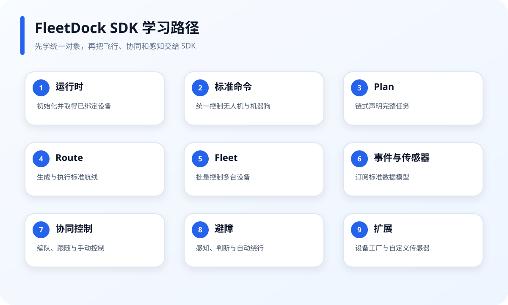

# FleetDock SDK 教学 Demo

本目录面向 FleetDock SDK 学习，基于 SDK 0.3.0 的公开能力重新设计。

## 使用方法

Notebook 直接通过 `from fleetdock_runtime import FleetDock` 使用当前应用自动生成的设备运行时。

1. 在 FleetDock IDEA 中打开本应用。
2. 从 `00_FleetDock_SDK_学习导航.ipynb` 开始。
3. 按编号运行 Notebook。
4. 标注“需要仿真”的课程，先在 FleetDock IDEA 中启动对应数量的仿真设备。

控制类 Notebook 不附带布尔安全开关；执行控制单元即提交 SDK 任务。
因此请按 Notebook 标注准备仿真环境，不要把仿真课程直接用于真机。

## 能力覆盖

| 能力域 | Notebook |
|---|---|
| FleetDock IDEA 运行时、设备绑定、环境变量 | 01 |
| DeviceFactory、标准设备、标准响应 | 02、12 |
| 即时命令、强类型移动目标 | 02 |
| Plan、任务结果、同步和异步执行 | 03、08 |
| Route、Waypoint、圆形/网格/螺旋/走廊 | 04 |
| Fleet、设备筛选和多设备 Plan | 05 |
| 标准事件、状态快照 | 06 |
| 标准传感器、一次读取、相机帧 | 07 |
| 诊断、就绪和错误模型 | 08 |
| FormationLayout、FollowSession | 09 |
| ManualControlSession | 10 |
| LiDAR Provider、标准障碍物、避障接入 | 11 |
| RobotDog、自定义传感器 | 12 |

## 目录说明

- `*.ipynb`：教学 Notebook。
- `assets/*.svg`：Notebook 中使用的教学图。
